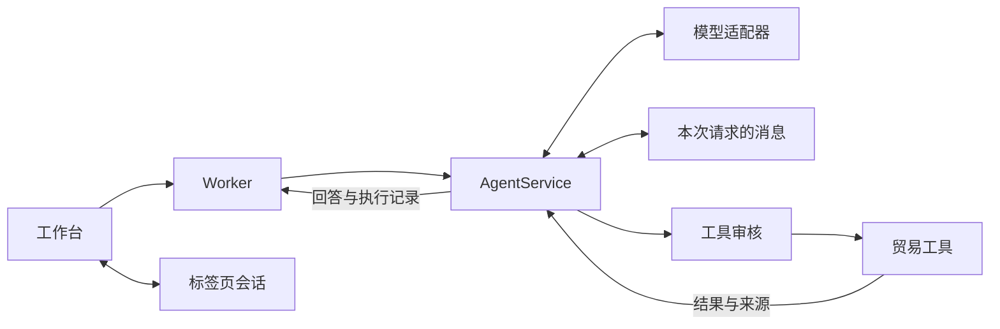

# Borderwise Agent 架构

核心流程参考 Hucci 写代码的《10 分钟学会设计 Agent 架构》。工作台继续支持本地规则。开启 AI 后，Worker 可以调用受审核的贸易工具，并随答案返回执行记录和可复查的来源。[视频](https://www.bilibili.com/video/BV1winH6DEgt/)

| 层 | 位置 | 职责 |
| --- | --- | --- |
| 领域层 | `worker/src/domain/`、`docs/engine.js` | 定义回答要求和工具审核规则，复用同一套货物复核规则。 |
| 应用层 | `worker/src/application/agent-service.mjs` | 读取会话，调用模型，审核并运行工具，将结果交回模型，汇总最终回答和来源。 |
| 适配层 | `worker/src/index.mjs`、`worker/src/adapters/`、`docs/session-store.js` | HTTP 鉴权与请求校验、会话保存、模型接入、官方税则查询与证据输出。Worker 入口负责接线。 |

## 会话与执行

- 标签页最多保存 12 轮对话，刷新可恢复。同一 Worker 只接收最近至多 8 条 AI 对话消息，整段历史最多 3 KiB。更换货物或开启新分析时重新开始会话，访问口令只保存在页面内存中。
- Worker 在每次请求内保存模型及工具消息。客户端只可传入用户和助手消息。每轮提问至多调用模型 4 次、审核 4 次工具请求。重复调用会被拦截，模型和工具共享 30 秒的请求时限。
- `review_shipment` 根据表单运行本地规则。`lookup_tariff` 校验目的地和 HS 编码后查询美国 USITC 或英国 HMRC。`official_sources` 提供按主题整理的官方入口。成功查到的基础税则附查询时间，适用税负仍需结合完整税号、原产地和额外措施复核。
- `plan_shipment_workflow` 根据货物资料和用户录入的节点，生成贸易术语分工、节点、交接单证、期限提醒和异常待办。`draft_freight_inquiry` 根据同一份货物和路线资料生成可复制的英文询价草稿。工作台也可直接在浏览器运行这两项功能。
- `compare_transport_quotes` 用与本地工作台相同的计算规则比较实际报价。附加费可录总额或分项，部分分项只计入已知小计。服务范围、报价有效期和汇率缺口影响排名。跨币种比较只向汇率接口发送币种，税费在基础运费以外另行核验。

## 接口与部署

Worker `POST` 接口接受 `question`、`shipment`、`report` 和 `history`。传入 `protocol: 2` 时返回 `answer`、`steps` 和 `sources`。旧请求继续收到 `{answer}`，工作台也能读取只返回答案的旧 Worker。

`protocol: 2` 可附带 `logistics.workflow` 和 `logistics.comparison`，合计最多 8 KiB。工作台仅在相关 AI 提问中附带已录入的物流记录或实际报价，演示报价限于本地。首次调用模型只传入物流上下文可用状态。Worker 提供期限检查和草稿，现场状态与后续操作仍由业务人员确认。

| `AI_PROVIDER` | 密钥 | 模型配置 |
| --- | --- | --- |
| `zhipu`（默认） | `ZHIPU_API_KEY` | `MODEL` 默认 `glm-5.3-flash`。可选 `ZHIPU_BASE_URL`、`THINKING`，兼容旧的 OpenAI 环境变量。 |
| `openai` | `OPENAI_API_KEY` | 设置支持工具调用的 `MODEL`，可选 `OPENAI_BASE_URL`。 |
| `anthropic` | `ANTHROPIC_API_KEY` | 设置支持工具调用的 `MODEL`，可选 `ANTHROPIC_BASE_URL`。 |

部署入口为 `worker/wrangler.toml`。在 Worker 设置 `ALLOWED_ORIGIN` 为工作台的 HTTPS 来源，并将 `APP_TOKEN` 和模型密钥存为 Worker Secrets。美国税则工具使用同源 `/api/tariffs/us`，部署工作台时需包含根目录的 `functions/`。

运行 `npm test` 可检查本地规则、会话、工具审核、接口兼容和模型适配器。涉及模型和官方税则的测试使用模拟响应。
